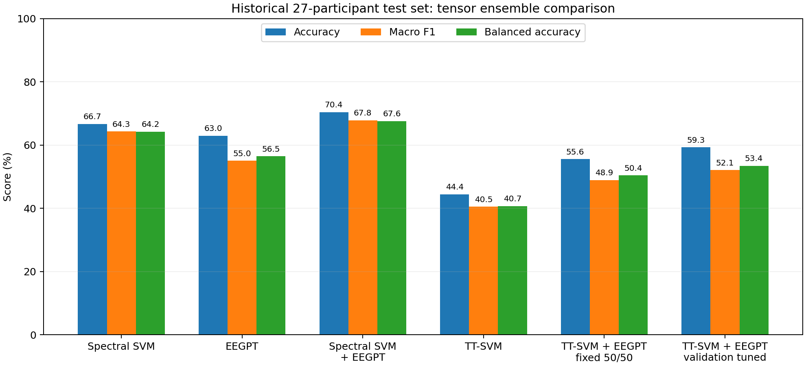
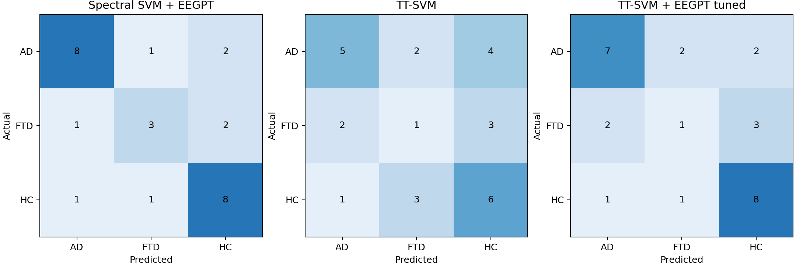
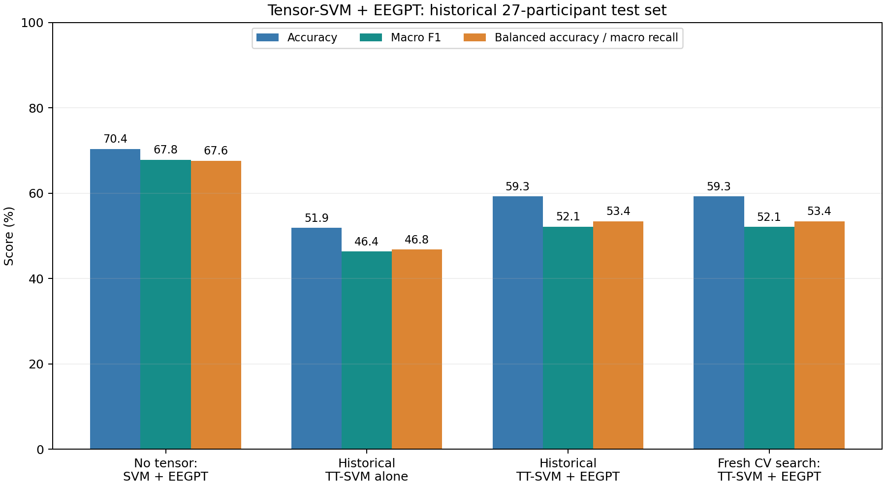
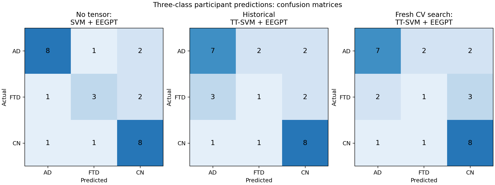

# Tensor Train SVM + fine-tuned EEGPT: fixed-split experiment

This run adds the previously unverified TT-SVM + EEGPT ensemble. EEGPT was reused, not retrained. All models predict AD/FTD/HC per participant.

Pipeline: saved log-mel windows → participant tensor (174 × 19 × 24 × 4) → training-only site normalization → shared Tensor Train projection → scaled balanced SVM → temperature-adjusted blend with raw-EEG EEGPT outputs.

The 121/26/27 participant split is unchanged. Rank/SVM choice used 5-fold CV within the 121 training participants. Blend weights/temperatures used only the 26 validation participants. The final TT-SVM was refitted on 147 development participants before test evaluation. This differs from the older standalone TT search, which selected settings by CV over all 147 development participants.

The test set was examined during previous project experiments. These are exploratory fixed-split results; this reuse of a fine-tuned EEGPT does not constitute a new nested cross-validation of the ensemble.

SVM settings: `{"rank": 4, "channel_rank": 8, "spectral_rank": 8, "C": 0.03, "kernel": "linear"}`.

Validation-selected blend: `{"svm_temperature": 0.75, "eegpt_temperature": 0.75, "svm_weight": 0.5, "val_macro_f1": 0.7000000000000001, "val_balanced_accuracy": 0.7095238095238096, "val_accuracy": 0.7307692307692307}`.

| Model | Test accuracy (%) | Test macro F1 (%) | Test balanced accuracy (%) | FTD recall (%) |
|---|---:|---:|---:|---:|
| Spectral SVM | 66.67 | 64.29 | 64.24 | 50.00 |
| EEGPT | 62.96 | 55.03 | 56.46 | 16.67 |
| Spectral SVM + EEGPT | 70.37 | 67.82 | 67.58 | 50.00 |
| TT-SVM | 44.44 | 40.49 | 40.71 | 16.67 |
| TT-SVM + EEGPT fixed | 55.56 | 48.89 | 50.40 | 16.67 |
| TT-SVM + EEGPT tuned | 59.26 | 52.08 | 53.43 | 16.67 |

The fixed 50/50 control uses SVM temperature 0.5 and EEGPT temperature 0.75, matching the old blend. It was specified before testing. The tuned blend may select zero weight for a branch; that would mean it selected a single-model endpoint rather than evidence for complementarity.

All 288 SVM candidates (1,440 inner SVM fits) and all 420 blend combinations were saved. Rankings used macro F1. Temperature-adjusted SVM scores are softmax scores, not clinically calibrated risk estimates.

See `svm_search.json`, `blend_search.json`, `metrics.json`, `source_hashes.json`, `splits.json`, `tt_svm_blend.joblib`, `probabilities.npz` and `test_participant_probabilities.json` for complete reproducible records.

## Historical-settings control

The separate historical TT-settings control reproduced the old standalone TT-SVM exactly (51.85% accuracy). Its validation-tuned EEGPT blend reached 59.26% accuracy, 52.12% macro F1 and 53.43% balanced accuracy. The fresh training-CV-selected ensemble above reached 59.26%, 52.08% and 53.43%, respectively. Both are below the reproduced no-tensor ensemble.

See [the control report](historical_tt_control/REPORT.md) for its settings, validation-selection history and probabilities.
