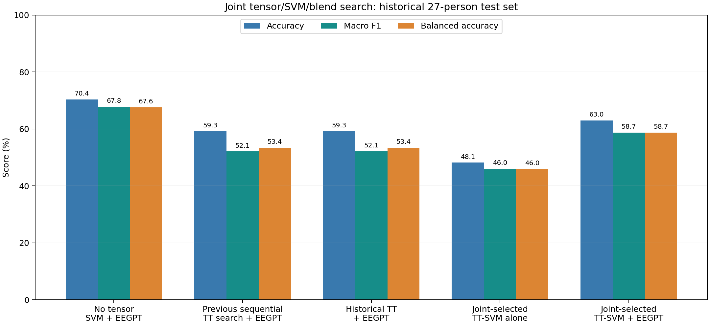
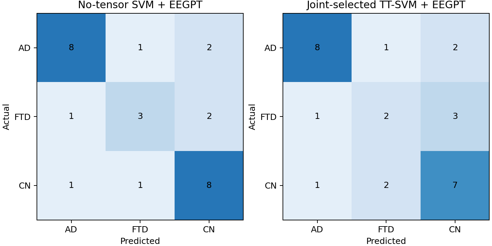

# Joint tensor-SVM + EEGPT parameter search

The ensemble, rather than the standalone SVM, is the selection target. EEGPT was fixed. TT/SVM candidates were fitted on121 training participants; all joint selections use26 validation participants. Five-fold training-only SVM CV is a tie-break/stability diagnostic. Final TT/SVM refitting uses147 development participants; test results use the historical27-person split.

**720 TT/SVM candidates × 420 blend choices = 302,400 joint validation comparisons.**

Selected settings: `{"svm_candidate": 226, "blend_candidate": 115, "config": {"rank": 8, "channel_rank": 4, "spectral_rank": 16, "C": 1.0, "kernel": "rbf", "gamma": "scale"}, "svm_temperature": 0.75, "eegpt_temperature": 1.0, "svm_weight": 0.5, "val_macro_f1": 0.801058201058201, "val_balanced_accuracy": 0.801058201058201, "val_accuracy": 0.8076923076923077, "inner_svm_macro_f1": 0.5057708702209981}`.

## Actual test results

| Model | Accuracy (%) | Macro F1 (%) | Balanced accuracy (%) | FTD recall (%) |
|---|---:|---:|---:|---:|
| No-tensor SVM + EEGPT | 70.37 | 67.82 | 67.58 | 50.00 |
| Previous sequential TT search + EEGPT | 59.26 | 52.08 | 53.43 | 16.67 |
| Historical TT settings + EEGPT | 59.26 | 52.12 | 53.43 | 16.67 |
| Joint-selected TT-SVM alone | 48.15 | 46.03 | 45.96 | 33.33 |
| Joint-selected TT-SVM + EEGPT | 62.96 | 58.73 | 58.69 | 33.33 |

**Validation maxima below are selection scores, not test results or isolated parameter effects.** Other settings vary between rows; the best ensemble F1 determines the whole row. Gamma applies only to RBF kernels. A larger search on26 validation participants can overfit validation. The previously examined test split remains exploratory.

## Best saved ensemble result for each parameter value

| Parameter | Value | Validation macro F1 (%) | Validation BA (%) | Validation accuracy (%) | SVM candidate | Blend candidate |
|---|---|---:|---:|---:|---:|---:|
| C | 0.03 | 76.03 | 77.14 | 76.92 | 600 | 10 |
| C | 0.1 | 75.56 | 75.71 | 76.92 | 305 | 115 |
| C | 0.3 | 79.95 | 80.48 | 80.77 | 223 | 240 |
| C | 1.0 | 80.11 | 80.11 | 80.77 | 226 | 115 |
| C | 10.0 | 75.56 | 75.71 | 76.92 | 327 | 220 |
| C | 3.0 | 78.66 | 78.31 | 80.77 | 261 | 372 |
| channel_rank | 4 | 80.11 | 80.11 | 80.77 | 226 | 115 |
| channel_rank | 8 | 77.04 | 76.77 | 76.92 | 113 | 241 |
| eegpt_temperature | 0.75 | 80.11 | 80.11 | 80.77 | 226 | 95 |
| eegpt_temperature | 1.0 | 80.11 | 80.11 | 80.77 | 226 | 115 |
| eegpt_temperature | 1.25 | 80.11 | 80.11 | 80.77 | 226 | 135 |
| eegpt_temperature | 1.5 | 80.11 | 80.11 | 80.77 | 226 | 241 |
| gamma | "scale" | 80.11 | 80.11 | 80.77 | 226 | 115 |
| gamma | 0.01 | 75.56 | 75.71 | 76.92 | 322 | 115 |
| gamma | 0.1 | 79.95 | 80.48 | 80.77 | 223 | 240 |
| gamma | 1.0 | 75.07 | 75.71 | 76.92 | 134 | 115 |
| kernel | "linear" | 76.09 | 75.34 | 76.92 | 110 | 30 |
| kernel | "rbf" | 80.11 | 80.11 | 80.77 | 226 | 115 |
| rank | 16 | 75.56 | 75.71 | 76.92 | 412 | 135 |
| rank | 32 | 76.03 | 77.14 | 76.92 | 600 | 10 |
| rank | 4 | 77.04 | 76.77 | 76.92 | 23 | 10 |
| rank | 8 | 80.11 | 80.11 | 80.77 | 226 | 115 |
| spectral_rank | 16 | 80.11 | 80.11 | 80.77 | 226 | 115 |
| spectral_rank | 24 | 78.66 | 78.31 | 80.77 | 261 | 372 |
| spectral_rank | 8 | 77.04 | 76.77 | 76.92 | 23 | 10 |
| svm_temperature | 0.5 | 77.04 | 76.77 | 76.92 | 23 | 10 |
| svm_temperature | 0.75 | 80.11 | 80.11 | 80.77 | 226 | 115 |
| svm_temperature | 1.0 | 80.11 | 80.11 | 80.77 | 226 | 241 |
| svm_temperature | 1.5 | 80.11 | 80.11 | 80.77 | 226 | 327 |
| svm_temperature | 2.0 | 80.11 | 80.11 | 80.77 | 226 | 412 |
| svm_weight | 0.0 | 64.13 | 66.19 | 69.23 | 90 | 0 |
| svm_weight | 0.05 | 64.13 | 66.19 | 69.23 | 90 | 1 |
| svm_weight | 0.1 | 64.13 | 66.19 | 69.23 | 90 | 2 |
| svm_weight | 0.15000000000000002 | 67.63 | 69.52 | 73.08 | 203 | 66 |
| svm_weight | 0.2 | 67.63 | 69.52 | 73.08 | 281 | 130 |
| svm_weight | 0.25 | 67.63 | 69.52 | 73.08 | 281 | 110 |
| svm_weight | 0.30000000000000004 | 73.97 | 74.29 | 76.92 | 261 | 69 |
| svm_weight | 0.35000000000000003 | 75.56 | 75.71 | 76.92 | 447 | 70 |
| svm_weight | 0.4 | 76.44 | 76.77 | 76.92 | 226 | 50 |
| svm_weight | 0.45 | 80.11 | 80.11 | 80.77 | 226 | 135 |
| svm_weight | 0.5 | 80.11 | 80.11 | 80.77 | 226 | 115 |
| svm_weight | 0.55 | 80.11 | 80.11 | 80.77 | 226 | 95 |
| svm_weight | 0.6000000000000001 | 80.11 | 80.11 | 80.77 | 226 | 327 |
| svm_weight | 0.65 | 80.11 | 80.11 | 80.77 | 226 | 412 |
| svm_weight | 0.7000000000000001 | 80.11 | 80.11 | 80.77 | 226 | 392 |
| svm_weight | 0.75 | 78.66 | 78.31 | 80.77 | 261 | 372 |
| svm_weight | 0.8 | 75.36 | 75.71 | 76.92 | 437 | 352 |
| svm_weight | 0.8500000000000001 | 68.41 | 68.31 | 69.23 | 412 | 17 |
| svm_weight | 0.9 | 68.41 | 68.31 | 69.23 | 412 | 18 |
| svm_weight | 0.9500000000000001 | 71.84 | 71.64 | 73.08 | 412 | 19 |
| svm_weight | 1.0 | 68.41 | 68.31 | 69.23 | 412 | 20 |

All joint combinations and metrics are in `all_joint_candidates.jsonl.gz`; `svm_configurations.json` defines candidate IDs. Each SVM’s best blend is in `svm_search.json`; all420 blends for the selected SVM are in `blend_search.json`. Source hashes, model, predictions, probabilities and inner-CV diagnostics are saved alongside this report.
