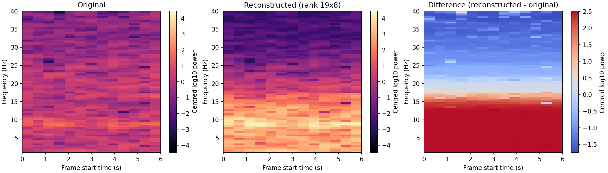
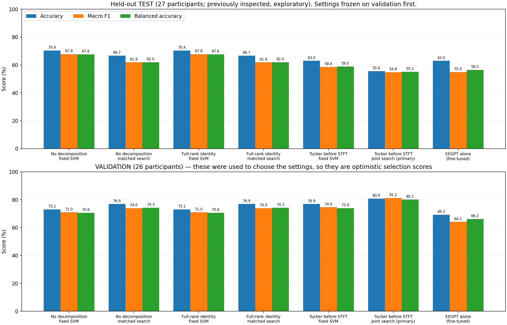
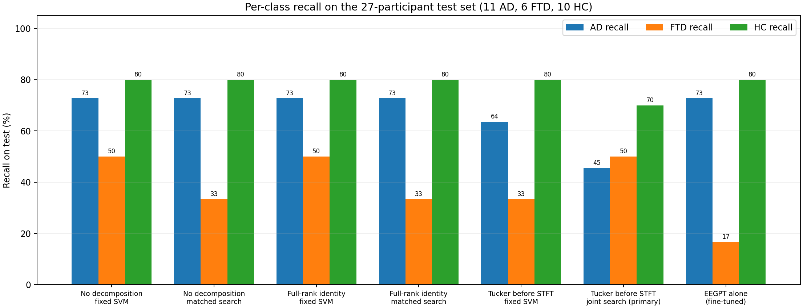
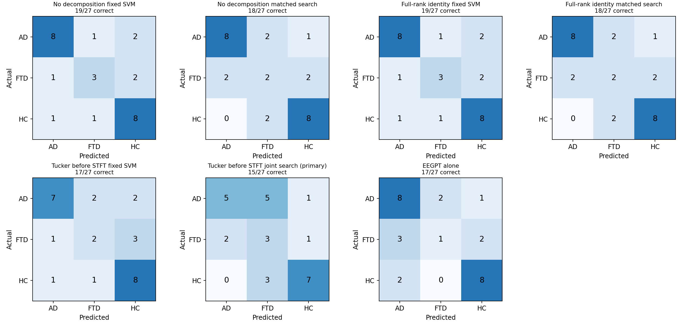
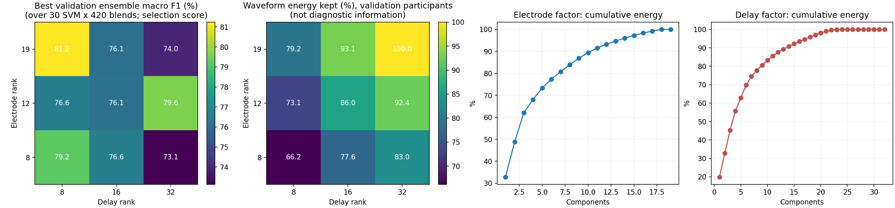

# Waveform Tucker-2 reconstruction BEFORE the STFT, then SVM + fine-tuned EEGPT

Everything below was run by `experiment_waveform_tucker_before_stft.py`. EEGPT was **not** retrained (saved probabilities reused); existing experiments and caches were not modified.

```text
rebuilt 8 s / 128 Hz / 19-ch windows -> delay tensor (19, 32, 993) -> training-only shared Tucker-2 (electrode x delay)
-> anti-diagonal averaging back to (19, 1024) -> same STFT / log-mel (float16) / mean+SD summaries (912) -> site-normalised SVM
-> probability blend with the unchanged fine-tuned EEGPT -> participant-level AD / FTD / HC
```

## Data and split (unchanged)

174 independent participants (71 AD, 42 FTD, 61 HC; 88 AHEPA + 86 BrainLat). Historical split: 121 train / 26 validation / 27 test, identical to the saved split file. The 27-person test set (11 AD, 6 FTD, 10 HC) has been inspected in many earlier experiments, so **all test numbers are exploratory**. One test participant is worth 3.70 accuracy points.

Waveforms were rebuilt from the original recordings with the project's own harmonisation, QC and window-selection code. They match the saved 6,721-window cache: identical window ownership/counts/labels; rebuilt STFT values bitwise equal in 99.988% of entries (maximum difference 0.0020, one float16 step). The historical direct-SVM + EEGPT result was reproduced exactly from the stored cache (accuracy 70.37%, macro F1 67.82%).

## Test results (settings chosen on validation only, then frozen)

Recalls are AD / FTD / HC (%). The last column is the validation macro F1 used for selection (optimistic).

| Procedure | Accuracy % (correct) | Macro F1 % | Balanced accuracy % | Recall AD/FTD/HC | Validation macro F1 % |
|---|---:|---:|---:|---|---:|
| No decomposition fixed SVM | 70.37 (19/27) | 67.82 | 67.58 | 73 / 50 / 80 | 71.00 |
| No decomposition matched search | 66.67 (18/27) | 61.90 | 62.02 | 73 / 33 / 80 | 74.00 |
| Full-rank identity fixed SVM | 70.37 (19/27) | 67.82 | 67.58 | 73 / 50 / 80 | 71.00 |
| Full-rank identity matched search | 66.67 (18/27) | 61.90 | 62.02 | 73 / 33 / 80 | 74.00 |
| Tucker before STFT fixed SVM | 62.96 (17/27) | 58.64 | 58.99 | 64 / 33 / 80 | 74.63 |
| Tucker before STFT joint search (primary) | 55.56 (15/27) | 54.84 | 55.15 | 45 / 50 / 70 | 81.24 |
| EEGPT alone (fine-tuned, unchanged) | 62.96 (17/27) | 55.03 | 56.46 | 73 / 17 / 80 | 64.13 |
| Historical direct log-mel SVM + EEGPT (stored cache, reproduced) | 70.37 (19/27) | 67.82 | 67.58 | 73 / 50 / 80 | 71.00 |

Procedures: **C1** rebuilt waveforms with the historical SVM (PCA20, C=0.1, linear) and a validation-chosen blend; **C2** the same input with the 30-setting SVM search; **C3/C4** full-rank (19, 32) Tucker reconstruction, which must equal the input (identity control), with fixed / searched SVM; **P1** Tucker rank pair chosen on validation with the fixed historical SVM; **P2 (primary)** rank pair, SVM and blend chosen jointly on validation. All six were declared in `protocol.json` before test scoring.

Selected settings:

- `C1`: none (rebuilt raw waveforms); SVM `{"pca": 20, "C": 0.1, "kernel": "linear"}`; blend `{"svm_temperature": 0.5, "eegpt_temperature": 0.75, "svm_weight": 0.5}`; validation ensemble F1 71.00%, accuracy 73.08%
- `C2`: none (rebuilt raw waveforms); SVM `{"pca": 40, "C": 0.1, "kernel": "linear"}`; blend `{"svm_temperature": 0.75, "eegpt_temperature": 1.0, "svm_weight": 0.5}`; validation ensemble F1 74.00%, accuracy 76.92%
- `C3`: electrode rank 19, delay rank 32; SVM `{"pca": 20, "C": 0.1, "kernel": "linear"}`; blend `{"svm_temperature": 0.5, "eegpt_temperature": 0.75, "svm_weight": 0.5}`; validation ensemble F1 71.00%, accuracy 73.08%
- `C4`: electrode rank 19, delay rank 32; SVM `{"pca": 40, "C": 0.1, "kernel": "linear"}`; blend `{"svm_temperature": 0.75, "eegpt_temperature": 1.0, "svm_weight": 0.5}`; validation ensemble F1 74.00%, accuracy 76.92%
- `P1`: electrode rank 19, delay rank 16; SVM `{"pca": 20, "C": 0.1, "kernel": "linear"}`; blend `{"svm_temperature": 0.5, "eegpt_temperature": 0.75, "svm_weight": 0.5}`; validation ensemble F1 74.63%, accuracy 76.92%
- `P2`: electrode rank 19, delay rank 8; SVM `{"pca": 40, "C": 0.03, "kernel": "linear"}`; blend `{"svm_temperature": 0.75, "eegpt_temperature": 1.25, "svm_weight": 0.5}`; validation ensemble F1 81.24%, accuracy 80.77%

## Comparison with the earlier tensor work (same 27-person test set; earlier numbers copied from the handover, not re-run)

| Method | Accuracy % | Macro F1 % | Balanced accuracy % |
|---|---:|---:|---:|
| Direct log-mel SVM + EEGPT (no tensor) | 70.37 | 67.82 | 67.58 |
| Summary-first Tensor Train → SVM alone | 51.85 | 46.35 | 46.77 |
| Tucker AFTER log-mel, BEFORE pooling → SVM | 59.26 | 57.56 | 58.18 |
| Jointly selected TT/SVM + EEGPT | 62.96 | 58.73 | 58.69 |
| **New: waveform Tucker BEFORE STFT + EEGPT (P2)** | 55.56 | 54.84 | 55.15 |
| New: waveform Tucker BEFORE STFT → SVM alone (P2 SVM) | 51.85 | 51.85 | 51.82 |

The earlier rows used the same 174 people and split but different intermediate representations, and different amounts of search; they are context, not a controlled ablation. Note that the TT/Tucker-after-log-mel rows operate on summarised spectral tensors, whereas the new method changes the waveform before any spectral processing.

## Search that was run

- Tucker pilot grid (frozen before examining results): electrode ranks [8, 12, 19] x delay ranks [8, 16, 32], delay length 32; the (19, 32) cell is the identity control.
- Downstream SVM grid for **every** arm, including the no-decomposition arm: PCA {20, 40, none} x C {0.03, 0.1, 0.3, 1, 3} x {linear, RBF} = 30.
- Blend grid: 5 SVM temperatures x 4 EEGPT temperatures x 21 weights = 420 per SVM.
- 126,000 joint validation candidates were scored and saved (`all_validation_candidates.jsonl.gz`). The Tucker arms receive 9x as many candidates as the no-decomposition arm, which inflates their best validation score in expectation; C4 (identity arm) and the fixed-SVM controls P1/C1/C3 are included so that effect can be read off.
- A 5-fold training-only CV (factors, site statistics, scaler, PCA and SVM refit inside each fold) supplied the standalone-SVM tie-break score. It is **not** a nested evaluation of the ensemble, because the fine-tuned EEGPT already saw labels of its original training participants.

## Plots (plain-language explanation)

- `waveform_reconstruction.png`: one 8 s signal at electrode Cz — original, rebuilt, and the part that was removed. Rank 8x8 smooths more aggressively than the selected setting. Energy kept is a statement about signal size, **not** about diagnostic information.
- `spectrogram_before_after.png`: the same window's log-power spectrogram before/after, and their difference. Differences are concentrated where the low-rank filter attenuated frequencies.
- `score_comparison.png`: accuracy, macro F1 and balanced accuracy on the test set (top) and validation set (bottom). The validation panel is a selection score and is higher by construction.
- `class_recalls.png`: how many AD, FTD and HC participants were found by each procedure. FTD has only 6 test participants, so one person moves FTD recall by 16.7 points.
- `confusion_matrices.png`: rows are the true class, columns the predicted class; the title shows participants correct out of 27.
- `rank_grid_and_spectra.png`: validation F1 and kept waveform energy for each rank pair, and the cumulative energy of the electrode and delay factors.












## Interpretation

**Result: waveform Tucker-2 reconstruction before the STFT did not improve the ensemble on this split.** The primary jointly searched procedure (P2: electrode rank 19, delay rank 8) reached 55.56% test accuracy (15/27), 54.84% macro F1 and 55.15% balanced accuracy. The fixed-SVM variant (P1: electrode rank 19, delay rank 16) reached 62.96% / 58.64% / 58.99%. The no-decomposition ensemble reached 70.37% / 67.82% / 67.58% (19/27), and the full-rank identity reconstruction reproduced it exactly, as it must. With the same 30-setting SVM search, the no-decomposition arm (C2) and the identity arm (C4) both reached 66.67% / 61.90% / 62.02%.

- **The identity control worked.** C3 equals C1 and C4 equals C2 on every metric, confusion matrix and validation score, so the reconstruction, STFT, log-mel and SVM code path adds no difference of its own. Rebuilt participant features differ from the stored cache by at most 1.4e-5.
- **Validation and test disagree, in the direction expected from selection on 26 people.** P2 had the highest validation ensemble F1 (81.24%) but the lowest test F1 of the six procedures. The 3x3 rank grid is not monotonic (the best cell, rank 19 x 8, sits next to weak cells), which is what noise-driven selection looks like; nothing in it supports a smooth "more denoising helps" trend. The Tucker arms also received 9 times as many candidates as the no-decomposition arm.
- **Standalone SVMs got worse, not better.** Test macro F1 of the SVM alone was 51.85% (P2) and 55.66% (P1), against 64.29% for the no-decomposition SVM. Blending with EEGPT recovered part of this because EEGPT is unchanged.
- **What the reconstruction does.** The leading delay components are low-frequency, so a low delay rank acts as a data-adaptive low-pass filter (see `waveform_reconstruction.png`). At delay rank 8 the reconstruction keeps about 79% of the waveform energy at full electrode rank. This removes high-frequency content that the spectral baseline apparently uses, and the removed energy is not necessarily noise. Energy retention says nothing about whether disease-related information was kept.
- **Uncertainty.** One test participant is 3.70 accuracy points, so P1 vs. the baseline is a difference of two participants and P2 a difference of four. The test set was inspected in many earlier experiments, and this experiment cannot show that the method could never help; it shows that on this cohort and split, with the pilot grid specified in advance, it did not.
- **Not tested here.** Longer delay lengths (16/64), a wider rank grid, per-site factors or fitting the reconstruction only on one frequency band. The handover asked for the pilot grid to be frozen before looking at results, so these were not added after seeing the outcome.


## Limitations

- Fixed historical split, 27 test participants, test set previously inspected: exploratory only. A large joint search on 26 validation participants overfits; the best validation score is not expected performance.
- A single fine-tuned EEGPT checkpoint cannot be treated as leakage-free in arbitrary new folds; no nested CV of the ensemble was performed.
- The cohorts differ strongly in site, equipment and amplitude (a BrainLat amplitude confound has been observed before). A gain on this split would not establish clinical portability.
- Temperature-adjusted SVM softmax values are blend scores, not calibrated clinical risks.
- Low-rank reconstruction can remove weak disease-related signal as well as noise, and can keep strong artefacts.

## Files

`protocol.json` (written before test scoring), `selection.json`, `metrics.json`, `verification.json`, `all_validation_candidates.jsonl.gz`, `svm_search.json`, `parameter_best_results.json`, `inner_cv.json`, `inner_oof.npz`, `factors_train121.npz`, `factors_dev147.npz`, `model_P2.joblib`, `model_P1.joblib`, `probabilities.npz`, `participant_probabilities.json`, `retention.json`, `source_hashes.json`, `prepared/` (waveform cache, `waveform_manifest.json` with offsets/QC, `rebuild_audit.json`, fingerprint), `cache/` (per-arm feature caches).
