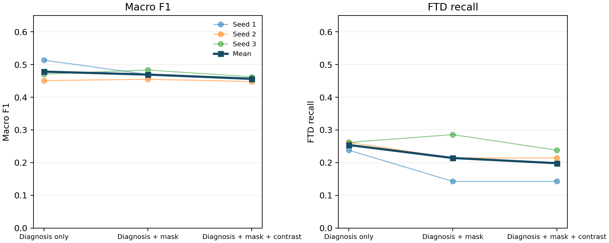

# Joint masked-context EEG experiment

## Question

Does a diagnosis head trained from the start improve AD/FTD/HC classification when paired with masked-context learning and a class-contrastive objective?

## Protocol

- Input: 6,719 existing eight-second log-mel EEG windows, each 19 electrodes x 24 frequency bins x 13 time frames. The fourth statistic mode used by G-NTF is not used here.
- People: 174 (71 AD, 42 FTD, 61 HC). Five held-out participant folds match the first G-NTF repeat. All windows from a person stay in one fold.
- Model: 88,899-parameter temporal/frequency CNN, two-layer context Transformer, participant-bag pooling, three-class diagnosis head from step one.
- Arms: diagnosis cross-entropy (CE); CE + 0.2 masked-latent Smooth L1; CE + 0.2 masked loss + 0.1 supervised contrastive loss between participant embeddings.
- Training: class-balanced subject bags, six sampled windows per person, up to 35 epochs. Twenty percent of outer-training people form an inner validation set. Choose the best epoch by participant macro F1, then balanced accuracy, then log loss. Outer-test people are evaluated only after checkpoint selection.
- Seeds: 20261116, 20261117, 20261118. Same five outer-test folds, different training/validation seeds. Each seed predicts all 174 people once per arm.
- This is wav2vec-inspired masked latent prediction on cached log-mel frames. It does not implement raw-waveform wav2vec 2.0 or vector quantization.

## Held-out results

Each entry is measured at participant level. The mean is across three correlated seed runs, not 522 independent patients.

| Arm | Accuracy, seed 1 / 2 / 3 | Mean accuracy | Macro F1, seed 1 / 2 / 3 | Mean macro F1 | Mean FTD recall |
|---|---:|---:|---:|---:|---:|
| Diagnosis only | 0.557 / 0.477 / 0.500 | 0.511 | 0.513 / 0.451 / 0.471 | 0.478 | 0.254 |
| Diagnosis + mask | 0.534 / 0.500 / 0.511 | 0.515 | 0.469 / 0.455 / 0.483 | 0.469 | 0.214 |
| Diagnosis + mask + contrast | 0.517 / 0.489 / 0.500 | 0.502 | 0.458 / 0.448 / 0.462 | 0.456 | 0.198 |

The diagnosis-only arm has the highest mean macro F1 (0.478) and mean FTD recall (0.254). Masking alone has similar mean accuracy (0.515 versus 0.511), but lower macro F1 (0.469). The added class-contrastive objective lowers both mean macro F1 (0.456) and FTD recall (0.198). These small, variable differences do not establish a reliable gain from masking or contrastive learning.

Across the three supervised runs, 32 of 126 repeated FTD predictions are correct, 40 are called AD, and 54 are called HC. These are three predictions for each of 42 people, not 126 independent people. FTD confusion involves both AD and HC.

For context, G-NTF on these same outer-test people in its first repeat gave accuracy 0.534, macro F1 0.405, and FTD recall 0.000. This is a descriptive matched-subject reference: the representation, model selection, calibration, and number of seeds differ. Its full three-repeat summary is a separate result.

## Interpretation and limits

The joint objectives did not resolve the AD/FTD confusion in this experiment. Validation-selected epochs vary widely, and the cohort is small for training a neural encoder from scratch. The cached log-mel input retains only 13 time frames per window, which may limit masked-context learning. A larger unlabeled raw-EEG corpus and true two-stage pretraining would test a different hypothesis. No result here is external clinical validation.

The cached moderate-preprocessing input inherits the source pipeline's limitation that EEGLAB discontinuity annotations were not explicitly rejected. Outputs in each seed directory contain protocol, per-fold checkpoints, histories, predictions, and summary metrics.
